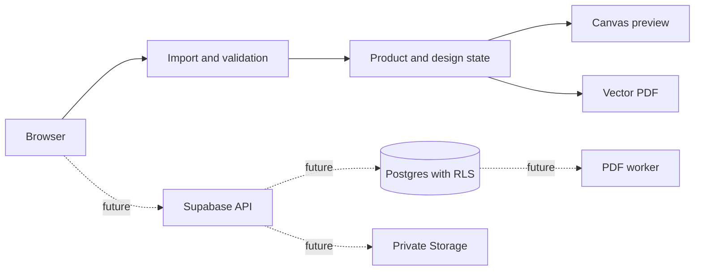

# Independent audit handoff — Cartaz Economix

> Living document updated after the English functional MVP. Read this before auditing the code.  
> Evidence labels: `[VERIFIED]` executed or observed; `[CODE REVIEWED]` inspected without execution; `[ASSUMPTION]` planned or dependent on external infrastructure.

## Index

1. [Overview](#1-overview)
2. [Stack and dependencies](#2-stack-and-dependencies)
3. [Application map](#3-application-map)
4. [Authentication and authorization](#4-authentication-and-authorization)
5. [Data model](#5-data-model)
6. [Attack surface](#6-attack-surface)
7. [Endpoints and functions](#7-endpoints-and-functions)
8. [Known security risks](#8-known-security-risks)
9. [Known bugs and limitations](#9-known-bugs-and-limitations)
10. [Tests](#10-tests)
11. [Test data and accounts](#11-test-data-and-accounts)
12. [Reviewer checklist](#12-reviewer-checklist-for-astra)
13. [Suggested reviewer prompt](#13-suggested-reviewer-prompt)

## 1. Overview

Cartaz Economix lets supermarket staff create reusable poster designs, import product data, correct validation errors, preview posters, and download a vector PDF. The primary flow is Design → Products → Review data → Preview → Output (`src/features/generation/GeneratePage.tsx:12-45`). `[CODE REVIEWED]`

The published artifact is a private functional preview. It is not a production multi-user deployment: design, product, brand, and batch state persist in the browser (`src/store/appStore.ts:25-47`). `[CODE REVIEWED]`

Run locally:

```bash
npm install
npm run dev
npm run check
npm test
npm run build
npm audit
```

`VITE_SUPABASE_URL` and `VITE_SUPABASE_ANON_KEY` activate Supabase Auth (`src/lib/supabase.ts:3-7`). No other secrets belong in the frontend.

## 2. Stack and dependencies

Direct versions are declared in `package.json:12-36`.

| Dependency | Declared version | Purpose | Handles untrusted input |
| --- | --- | --- | --- |
| React / React DOM | ^18.3.1 | UI | Yes, displays imported product text |
| React Router DOM | ^7.18.5 | Hash routing | URL path and query string |
| Zustand | ^5.0.2 | Preview state persistence | Yes, stored designs/products |
| read-excel-file | ^5.8.0 | XLSX parser | **Yes** |
| pdf-lib | ^1.17.1 | Vector PDF generation | **Yes** |
| @supabase/supabase-js | ^2.47.10 | Auth adapter | Credentials and sessions |
| Radix Avatar/Dialog | ^1.1.x | Accessible primitives | Not currently material |
| Lucide React | ^0.468.0 | Icons | No |
| clsx / tailwind-merge | ^2.1.1 / ^2.6.0 | CSS composition | No direct data parsing |

`npm audit --json` on 2026-10-30 returned 0 known vulnerabilities. `[VERIFIED]` Major updates remain available for several UI/build packages; no automatic major migration was performed. `[VERIFIED]`

## 3. Application map

Routes are lazy-loaded in `src/App.tsx:8-30` and are mounted only after the auth context reports a user.

| Route | Screen | Login gate |
| --- | --- | --- |
| `/#/` | Dashboard | Auth context |
| `/#/designs` | Designs library | Auth context |
| `/#/designs/:id/edit` | Visual editor | Auth context |
| `/#/generate` | Five-step batch wizard | Auth context |
| `/#/files` | Batch history/reprint | Auth context |
| `/#/settings` | Brand/account preview settings | Auth context |

Critical modules:

- Import and validation: `src/domain/products.ts:6-101`.
- Currency/EAN formatting: `src/domain/format.ts:1-55`.
- Shared design/product contracts: `src/domain/types.ts:1-107`.
- Browser preview: `src/components/PosterCanvas.tsx:1-52`.
- Vector PDF: `src/domain/pdf.ts:5-100`.
- Editor: `src/features/editor/EditorPage.tsx:1-31`.



Solid arrows are implemented; dotted arrows are production architecture only. `[VERIFIED]`

## 4. Authentication and authorization

When Supabase variables exist, the provider reads the session, subscribes to auth changes, signs in with password, signs out, and starts password recovery (`src/features/auth/AuthProvider.tsx:31-65`). `[CODE REVIEWED]`

Without Supabase, any non-empty preview form creates a local marker in `localStorage` and a fixed preview identity (`src/features/auth/AuthProvider.tsx:23-28,48-52`). This is not authentication. The hosted Site's owner-private gate is the only external access boundary for the preview. `[VERIFIED]`

There are no database migrations, tables, RLS policies, Storage buckets, SQL policies, service-role keys, edge functions, or server authorization in this repository. `[VERIFIED]` Therefore there is no SQL to reproduce and no claim of account isolation.

Frontend-only controls: every design/product/batch operation and all route gating in preview mode. Treat all of them as untrusted if a backend is added.

## 5. Data model

TypeScript contracts are in `src/domain/types.ts:1-107`:

- `Product`: all 13 business fields; EAN is `string`; money is integer cents.
- `Design`: physical size, orientation, colors, version, and element array.
- `DesignElement`: type, physical geometry, typography, dynamic field, fitting and price style.
- `Batch`: designs, copied product snapshot, copy count, output mode, status, date.

No database schema or migration has been applied. `[VERIFIED]` User-controlled fields include design name, text elements, product description/reference/EAN/note, imported cell values, colors, and local serialized objects.

## 6. Attack surface

| Input | Entry point | Validation | Escaping/sanitization | Limit |
| --- | --- | --- | --- | --- |
| CSV text/paste | `GeneratePage.tsx:27,40` | 2 million characters, header mapping and product validation | React text escaping; formula prefix neutralization | 2M characters / 5,000 mapped rows |
| `.csv`/`.xlsx` upload | `products.ts:46-56` | Extension, basic signature/binary check, 16 MB, 5,000 rows, 64 columns | Cells converted to strings; formula prefixes handled | 16 MB / 5,000 / 64 |
| Product text | `products.ts:55-90` | Required description/price; length warning | Rendered as React text; PDF strips controls/emoji | Description warning at 240 chars |
| EAN | `products.ts:61-62,86-87` | String; warns unless 8/12/13/14 digits | Digits-only editing in the table | 14 expected digits; no hard maximum in imported string |
| Money | `format.ts:8-19` | Finite value converted to integer cents | Non-numeric currency symbols removed | No explicit absolute maximum |
| Design JSON | Zustand persistence | TypeScript only at creation time | No runtime schema on reload | Browser quota only |
| URL design id | `App.tsx:26`; editor lookup | Lookup; missing id shows not found | Not interpolated into HTML | No explicit length limit |
| Login form | `LoginPage.tsx:56-76` | HTML required/email only | React text rendering | No explicit length limit |
| PDF batch | `GeneratePage.tsx:21-35` | Errors block progress; copies 1–20; 1,000-page browser cap | PDF text filter | 1,000 pages |

Image upload is intentionally disabled (`src/features/editor/EditorPage.tsx:25`) because private Storage and content validation are unavailable. `[VERIFIED]`

## 7. Endpoints and functions

No application-owned endpoint, RPC, edge function, or worker exists. `[VERIFIED]`

Potential Supabase Auth calls:

| Operation | SDK call | Caller | Validation/rate limit |
| --- | --- | --- | --- |
| Session read | `auth.getSession()` | Browser | Provider-managed; not verified here |
| Sign in | `auth.signInWithPassword()` | Browser | Supabase-managed; project policy unknown |
| Sign out | `auth.signOut()` | Browser | Supabase-managed |
| Recovery | `auth.resetPasswordForEmail()` | Browser | Supabase-managed; redirect policy unknown |

Malformed spreadsheet and PDF errors are caught and shown as text in the wizard (`GeneratePage.tsx:24-33`). `[CODE REVIEWED]`

## 8. Known security risks

| Severity | Finding | Location | Current mitigation | Missing control |
| --- | --- | --- | --- | --- |
| High | Preview auth is a local marker, not authentication | `AuthProvider.tsx:23-28,48-52` | Owner-private Site gate and explicit preview warning | Production must require Supabase and remove preview sign-in |
| High | No server authorization/RLS/Storage isolation | repository-wide | No remote data is stored | Add migrations, RLS tests, private buckets, signed paths |
| High | XLSX parser receives compressed content before row/column limits can be checked; a crafted workbook may consume memory | `products.ts:45-51` | 16 MB outer-file limit | Server inspection, decompressed-size/time limits, worker isolation |
| Medium | A permitted 1,000-page PDF is still generated on the browser main thread | `GeneratePage.tsx:29-33`; `pdf.ts:80-92` | 1,000-page hard cap | Queue, cancellation, server worker and lower interactive cap |
| Medium | Upload checks extension and basic bytes, but not MIME consistency or decompressed XLSX structure | `products.ts:46-53` | Extension, ZIP signature and binary-CSV checks | Server-side parser and full archive inspection |
| Medium | Entire product/design/batch snapshots persist in `localStorage` | `appStore.ts:25-47` | Preview warning and reset action | Do not store real data locally; authenticated server persistence |
| Medium | Hosted security headers were not independently inspected | hosting configuration outside repo | Private publication | Verify CSP, frame-ancestors, HSTS, Referrer-Policy, Permissions-Policy |
| Low | Formula neutralization covers `=`, `+`, `@` but not a leading `-` because negative prices may be valid | `format.ts:21-24` | No spreadsheet export of imported cells | Separate numeric parsing from exported text and prefix all dangerous exports |
| Low | Standard PDF fonts replace emoji with a square and may reject unsupported Unicode outside WinAnsi | `pdf.ts:14-16,69-70` | Control/emoji replacement | Embed a vetted Unicode font and test font subsetting |
| Low | Local IDs use a non-cryptographic fallback where `crypto.randomUUID` is unavailable | `lib/id.ts:1-4` | IDs are not authorization boundaries | Server-generated UUIDs for persisted records |

No `dangerouslySetInnerHTML`, `innerHTML`, `eval`, or remote URL fetching exists in application source. `[CODE REVIEWED]` This reduces current XSS/SSRF exposure but is not a guarantee for future image/PDF workers.

## 9. Known bugs and limitations

- `[VERIFIED]` Production Supabase database, RLS, Storage, worker, cross-device history, email recovery configuration, and account isolation are incomplete.
- `[VERIFIED]` Image insertion is disabled.
- `[VERIFIED]` Undo/redo controls are visible but disabled; editor autosave exists, version restore UI does not.
- `[CODE REVIEWED]` Browser preview and PDF share contracts but not the exact same font metrics/layout implementation; long text can differ.
- `[VERIFIED]` PDF output is one combined file only; per-product output is not implemented.
- `[CODE REVIEWED]` Archive removes a local design after confirmation; there is no undo/restore.
- `[CODE REVIEWED]` Mixed page sizes are supported by PDF pages, but the UI does not show grouping controls.
- `[VERIFIED]` Offline reload works for local state after assets are cached by the browser, but no service worker/offline guarantee exists.
- `[VERIFIED]` Concurrent editing in two tabs uses last-write-wins localStorage behavior.
- `[VERIFIED]` EAN 8/12/13/14 and leading zero behavior is validated; checksum validity is not checked.
- `[VERIFIED]` Dot/comma monetary parsing and 0.99/1,000.00 cases are tested; absolute upper bounds and negative business rules are incomplete.
- `[CODE REVIEWED]` A 120-character description exercises shrink/wrap logic in fixtures, but pixel-perfect browser/PDF parity is not asserted.

## 10. Tests

Automated tests are in `src/domain/products.test.ts` and `src/domain/pdf.test.ts`.

Last run on 2026-10-30: 2 files, 9 tests, all passed. `[VERIFIED]` Covered: comma/dot currency, quoted CSV, leading-zero EAN, required values, 10-page PDF, and second-design page doubling.

Manual browser run: Designs loaded, editor loaded, five wizard steps completed with 10 sample products, vector PDF generated/downloaded, and batch saved. `[VERIFIED]`

Not covered: component unit tests, upload through the browser chooser, malformed XLSX corpus, E2E mobile viewports, RLS, Storage, real Supabase Auth, load tests, accessibility automation, visual PDF comparison, cancellation, or unstable-network behavior.

## 11. Test data and accounts

Ten fictional products are in `src/domain/fixtures.ts`; one EAN starts with zero and one description is intentionally long. No real store data is included. `[CODE REVIEWED]`

Preview entry: `team@economix.example` / `private-preview`. These are labels, not credentials. `[VERIFIED]`

For production isolation tests, create `user-a@economix.test` and `user-b@economix.test` in a disposable Supabase project. Build one valid CSV from `TEMPLATE_CSV` (`products.ts:103`) and one malicious/invalid corpus with formula prefixes, oversized values, duplicate EANs, numeric EANs, missing prices, MIME mismatches, SVG scripts, and compressed XLSX bombs. Do not use real customer or store data.

## 12. Reviewer checklist for Astra

- [ ] Confirm the private Site gate cannot be bypassed; then remove/disable local preview auth in a production build.
- [ ] Add Supabase migrations and RLS. Authenticate as A, copy A's design/product/batch IDs, authenticate as B, and attempt read/update/delete directly through the API. Expected: denied.
- [ ] Test private Storage path substitution and overwrite attempts between A and B. Expected: denied.
- [ ] Upload extension/MIME/signature mismatches, encrypted XLSX, malformed ZIP central directories, high compression ratios, and more than 16 MB. Expected: rejected before expensive parsing.
- [ ] Paste input above the intended character limit and import 1, 100, 1,000, and 5,000 products. Measure main-thread blocking and memory.
- [ ] Attempt PDF jobs above the page cap, with 20 copies and a second design. Expected: bounded and cancellable.
- [ ] Test EAN values with 8/12/13/14 digits and leading zeros; verify text survives import, state, preview, PDF, and any export.
- [ ] Test `9,99`, `9.99`, `1.000,00`, `1,000.00`, zero, negative, extremely large values, and promotional price above regular price.
- [ ] Test 120+ characters, empty text, combining marks, RTL, emoji, control characters, and unsupported PDF glyphs.
- [ ] Search for `dangerouslySetInnerHTML`, `innerHTML`, `eval`, URL fetches, service-role secrets, and sensitive logging.
- [ ] Open the same design in two tabs, edit concurrently, interrupt the network during future remote save, and verify conflict behavior.
- [ ] Inspect production CSP, frame policy, HSTS, Referrer-Policy, Permissions-Policy, caching, and source-map exposure.
- [ ] Run Lighthouse accessibility, keyboard-only navigation, screen-reader checks, and 390/768/1440 viewport tests.

## 13. Suggested reviewer prompt

> You are Astra, an independent bug and security reviewer. Read `docs/AUDIT_HANDOFF.md` first, then audit both the code and the running application. Do not trust `[CODE REVIEWED]` or `[ASSUMPTION]` claims without verification, and treat `[VERIFIED]` only as historical evidence. Prioritize findings as critical, high, medium, or low. For every finding provide the exact file/line, prerequisites, reproducible steps—including direct API calls when relevant—observed evidence, impact, and a concrete remediation. Focus on authentication, RLS/IDOR, private Storage, spreadsheet parsing, formula injection, malicious uploads, XSS across editor/preview/PDF, PDF resource exhaustion, race conditions, offline/network failure, and dependency/hosting headers. Compare browser preview with vector PDF using extreme product data, EANs, prices, Unicode, second designs, and mixed page sizes. Run tests, dependency audit, accessibility checks, and load tests. Clearly separate confirmed defects, architectural risks, and inconclusive tests. Identify anything this handoff omitted or stated incorrectly. Never modify real data; use disposable accounts and synthetic files only.

---

Current self-review count: **0 critical, 3 high, 4 medium, and 3 low**. The three weakest areas are the non-authenticating preview session, absent backend authorization/storage, and resource exhaustion risk in XLSX/PDF processing.
