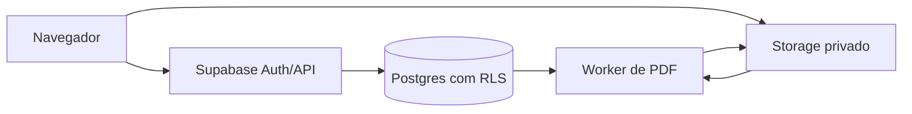

# Entrega para auditoria — Cartaz Economix

> Documento vivo. Estado: fase A (design system, navegação responsiva e base de autenticação).  
> Evidências: `[VERIFICADO]` foi executado; `[LIDO NO CÓDIGO]` foi apenas inspecionado; `[SUPOSIÇÃO]` ainda depende de implementação ou teste.

## Índice

1. [Visão geral](#1-visão-geral)
2. [Stack e dependências](#2-stack-e-dependências)
3. [Mapa da aplicação](#3-mapa-da-aplicação)
4. [Autenticação e autorização](#4-autenticação-e-autorização)
5. [Modelo de dados](#5-modelo-de-dados)
6. [Superfície de ataque](#6-superfície-de-ataque)
7. [Endpoints e funções](#7-endpoints-e-funções)
8. [Riscos já identificados](#8-pontos-de-risco-já-identificados)
9. [Bugs e limitações](#9-bugs-e-limitações-conhecidos)
10. [Testes](#10-testes)
11. [Dados e contas de teste](#11-dados-e-contas-de-teste)
12. [Checklist para Astra](#12-checklist-para-o-revisor-astra)
13. [Prompt sugerido](#13-prompt-sugerido-para-o-revisor)

## 1. Visão geral

O Cartaz Economix cria modelos de cartazes com campos dinâmicos, preenche esses modelos com produtos em lote e produz PDF para impressão. Usuários previstos são funcionários autenticados de supermercado. O fluxo alvo é: escolher modelo → informar produtos → corrigir erros → revisar cartazes → gerar PDF → imprimir ou baixar. `[LIDO NO CÓDIGO]` Nesta fase só estão implementados login de base, shell responsivo, início e placeholders das demais áreas (`src/App.tsx:12-24`).

- Desenvolvimento: `npm install && npm run dev`.
- Build: `npm run build`.
- Verificação TypeScript: `npm run check`.
- Testes automatizados: ainda não existem. `[VERIFICADO]`
- Produção: build estático Vite; Supabase será o backend. `[LIDO NO CÓDIGO]`

## 2. Stack e dependências

Versões declaradas em `package.json:12-31`.

| Dependência | Versão | Uso | Entrada não confiável? |
| --- | --- | --- | --- |
| react / react-dom | ^18.3.1 | Interface | Sim, futuramente renderiza conteúdo do usuário |
| react-router-dom | ^6.28.1 | Rotas no cliente | Sim, parâmetros de URL futuros |
| @supabase/supabase-js | ^2.47.10 | Autenticação e dados | Sim |
| @radix-ui/react-avatar | ^1.1.3 | Avatar acessível | Não diretamente |
| @radix-ui/react-dialog | ^1.1.4 | Diálogos acessíveis futuros | Sim, se exibir texto do usuário |
| lucide-react | ^0.468.0 | Ícones | Não |
| clsx / tailwind-merge | ^2.1.1 / ^2.6.0 | Classes CSS | Não diretamente |

Parser de planilha, upload, canvas e PDF ainda não foram adicionados. `[VERIFICADO]` `npm audit --json` executado em 30/10/2026: 0 vulnerabilidades conhecidas. `[VERIFICADO]` `npm outdated --json` apontou novas versões principais de React, tipos React, Lucide, Tailwind e TypeScript; elas não foram adotadas para evitar migrações sem benefício nesta fase. `[VERIFICADO]`

## 3. Mapa da aplicação

Rotas em `src/App.tsx:33-39`: `/`, `/designs`, `/gerar`, `/arquivos` e `/configuracoes` só são montadas depois da verificação de `user` em `src/App.tsx:27-29`, mas a verificação aceita uma sessão local de demonstração (`src/features/auth/AuthProvider.tsx:44-52`). Não há rota `/login` separada nesta fase. `[LIDO NO CÓDIGO]`

```text
src/components/          shell, navegação e superfícies compartilhadas
src/features/auth/       sessão, login e rota protegida
src/features/dashboard/  tela inicial
src/lib/                 cliente Supabase e utilitários
src/styles/              tokens e estilos globais
```

Editor/canvas, importação, preenchimento, PDF e assistente ainda não existem. `[VERIFICADO]`



O diagrama representa a arquitetura alvo, não a fase atual. `[SUPOSIÇÃO]`

## 4. Autenticação e autorização

`src/features/auth/AuthProvider.tsx:22-42` observa a sessão do Supabase quando configurado. Sem as variáveis `VITE_SUPABASE_URL` e `VITE_SUPABASE_ANON_KEY`, usa `localStorage` na chave `cartaz-economix-demo-session` (`src/features/auth/AuthProvider.tsx:16`). `[LIDO NO CÓDIGO]` A entrada usa e-mail e senha em `src/features/auth/LoginPage.tsx:56-76`; recuperação chama Supabase, mas expiração explícita e política de senha ainda não foram implementadas no projeto. `[LIDO NO CÓDIGO]`

Não existem tabelas, migrações, RLS, políticas SQL ou buckets nesta fase. Logo não há SQL a copiar nem isolamento de contas a validar. `[VERIFICADO]` Nenhuma `service_role` existe no código. `[LIDO NO CÓDIGO]`

Operações dependentes apenas do frontend: todas as rotas protegidas no modo de demonstração. Isso é risco alto e deve ser removido ou explicitamente bloqueado em produção.

## 5. Modelo de dados

Ainda não existem esquema ou migrações. `[VERIFICADO]` O modelo alvo inclui `designs`, `design_versions`, `assets`, `products`, `batches` e `batch_items`; tipos, índices, constraints e políticas serão documentados quando implementados. Campos futuros não confiáveis incluem nome do design, descrição, observação e `canvas_json`. `[SUPOSIÇÃO]`

## 6. Superfície de ataque

| Entrada | Onde entra | Validação | Escape/sanitização | Limite |
| --- | --- | --- | --- | --- |
| E-mail | `src/features/auth/LoginPage.tsx:56-59` | `type=email`, obrigatório | React escapa; enviado ao Supabase quando configurado | Não definido |
| Senha | `src/features/auth/LoginPage.tsx:61-69` | obrigatório | Não renderizada; enviada ao Supabase quando configurado | Não definido |
| Parâmetros de URL | `src/App.tsx:33-39` | rotas enumeradas | Não aplicável nesta fase | Não definido |
| `.xlsx`/`.csv` | Não implementado | Nenhuma | Nenhuma | Alvo: 16 MB |
| Imagens | Não implementado | Nenhuma | Nenhuma | Alvo: 5 MB |
| Texto de produto | Não implementado | Nenhuma | Nenhuma | Não definido |
| JSON do canvas | Não implementado | Nenhuma | Nenhuma | Não definido |

## 7. Endpoints e funções

Não há API própria, edge functions ou RPCs. `[VERIFICADO]` Quando Supabase é configurado, o frontend chama o endpoint gerenciado de login por senha através de `signInWithPassword` (`src/features/auth/AuthProvider.tsx:54`). Rate limit e tratamento de entrada malformada dependem do Supabase e ainda não foram verificados. `[SUPOSIÇÃO]`

## 8. Pontos de risco já identificados

| Severidade | Risco | Local | Mitigação atual | Falta |
| --- | --- | --- | --- | --- |
| Alta | Sessão demo pode liberar rotas sem autenticação real | `src/features/auth/AuthProvider.tsx:44-52` | Apenas separação visual | Impedir build de produção sem Supabase ou feature flag explícita |
| Média | Sessão demo persistida em `localStorage` | `src/features/auth/AuthProvider.tsx:16,24-25,50` | Guarda só um marcador, não senha | Remover no ambiente real; testar limpeza e expiração |
| Média | Ausência de cabeçalhos CSP, frame-ancestors, HSTS e Referrer-Policy | `vite.config.js:4-16` | Restrição de host só no dev/preview | Configurar no host e verificar resposta publicada |
| Média | Mensagens do provedor podem expor detalhe excessivo | `src/features/auth/LoginPage.tsx:13-19,71` | Mensagem é exibida como texto, sem HTML | Mapear erros para mensagens neutras e log seguro |
| Baixa | Formulários não têm limite explícito de comprimento | `src/features/auth/LoginPage.tsx:56-69` | Tipos HTML básicos | Adicionar limites e validação compartilhada |
| Alta | RLS, Storage privado e isolamento ainda inexistentes | não implementado | Nenhuma | Criar migrações e testes de usuário A/B antes de dados reais |
| Alta | Upload/planilha/PDF ainda sem defesas contra fórmulas, zip bomb, SVG ativo e DoS | não implementado | Funcionalidade ausente | Definir limites e validação no cliente e servidor |

XSS: não há `dangerouslySetInnerHTML` ou `innerHTML` no código atual. `[LIDO NO CÓDIGO]` Isso não cobre canvas, preview ou PDF futuros. Injeção em planilhas, upload malicioso, IDOR, DoS de lotes, corrida de salvamento e SSRF ainda não podem ser testados porque os módulos não existem. `[VERIFICADO]` Cookies de sessão são geridos pelo SDK/configuração futura; atributos e CSRF não foram verificados. `[SUPOSIÇÃO]`

## 9. Bugs e limitações conhecidos

- `[VERIFICADO]` Designs, editor, produtos, importação, geração, PDF e histórico são placeholders.
- `[VERIFICADO]` Modo demo aceita qualquer e-mail/senha não vazios.
- `[SUPOSIÇÃO]` EAN 8/12/13/14 com zeros, decimais BR, negativos, preço promocional maior, emojis, texto longo, centavos reduzidos, lotes 1/100/1000, segundo modelo, tamanhos mistos, duas abas e modo offline não foram implementados nem testados.
- `[LIDO NO CÓDIGO]` O roteamento usa hash; URLs finais terão `/#/rota` nesta fase.

## 10. Testes

Não há testes unitários, integração ou E2E e a cobertura automatizada é 0%. `[VERIFICADO]` Em 30/10/2026, `npm run check`, `npm run build` e `npm audit --json` passaram; o audit retornou 0 vulnerabilidades. `[VERIFICADO]` No navegador gerenciado, foram executados login demo, carregamento do painel e navegação até Designs em desktop. `[VERIFICADO]` O deploy privado abriu a barreira externa “Entre para acessar”, mas o aplicativo atrás dela não foi retestado em produção. `[VERIFICADO]` CSS mobile-first, bottom nav e alvos de 44 px foram inspecionados em `src/styles/index.css:57-65,95-102`; 390 px e 768 px ainda não foram verificados em viewports reais. `[LIDO NO CÓDIGO]`

## 11. Dados e contas de teste

No modo demo, use dados fictícios como `operador@economix.test`; nenhuma conta é criada. `[LIDO NO CÓDIGO]` Antes do backend, preparar `usuario-a@economix.test` e `usuario-b@economix.test`, uma planilha válida com 10 produtos fictícios e outra com erros deliberados. Nunca usar dados reais. `[SUPOSIÇÃO]`

## 12. Checklist para o revisor (Astra)

- [ ] Tentar acessar `/#/designs` sem sessão e confirmar redirecionamento; depois manipular `economix.demo.session` e registrar o bypass esperado nesta fase.
- [ ] Configurar Supabase de teste, autenticar A e B e verificar expiração, logout e mensagens de erro.
- [ ] Quando houver banco: usar o id de um design de A como B e tentar ler, editar e excluir por chamada direta. Esperado: negado pela RLS.
- [ ] Quando houver Storage: trocar paths/ids e tentar baixar e sobrescrever arquivos de outro usuário. Esperado: negado.
- [ ] Procurar `dangerouslySetInnerHTML`, `innerHTML`, `eval`, URLs externas no renderizador e dados não escapados.
- [ ] Importar fórmulas `=`, `+`, `-`, `@`, `.xlsx` comprimido anormalmente, MIME falso, SVG com script e arquivos acima dos limites.
- [ ] Testar EAN e todos os casos de borda listados na seção 9.
- [ ] Interromper rede durante upload, autosave e geração; abrir o mesmo design em duas abas.
- [ ] Inspecionar headers no deploy e rodar auditoria de dependências e Lighthouse.

## 13. Prompt sugerido para o revisor

> Você é Astra, revisor independente de bugs e segurança. Leia primeiro `docs/AUDIT_HANDOFF.md` e depois audite o código e o sistema em execução. Não confie nas marcações `[LIDO NO CÓDIGO]` ou `[SUPOSIÇÃO]`: verifique-as. Trate `[VERIFICADO]` como evidência histórica, não como garantia. Priorize achados em crítica, alta, média e baixa. Para cada achado, informe: título, severidade, arquivo e linha, pré-condições, passos reproduzíveis (incluindo chamada direta à API quando aplicável), impacto, evidência observada e correção sugerida. Teste autenticação, RLS/IDOR, Storage, upload, parser de planilhas, injeção de fórmula, XSS no editor/preview/PDF, limites de lote, concorrência e falhas de rede. Compare preview e PDF, valide texto extremo, EAN e preços brasileiros. Rode testes, auditoria de dependências e inspeção de headers. Diferencie claramente defeito confirmado, risco arquitetural e teste inconclusivo. Ao final, liste o que este relatório omitiu, afirmações incorretas encontradas e uma ordem de correção orientada por exploração e impacto. Não altere dados reais; use apenas contas e arquivos fictícios.

---

Resumo provisório da fase A: 3 riscos altos, 3 médios e 1 baixo identificados. Pontos mais frágeis: bypass do modo demo, ausência atual de RLS/Storage e módulos futuros de upload/renderização ainda sem controles.
